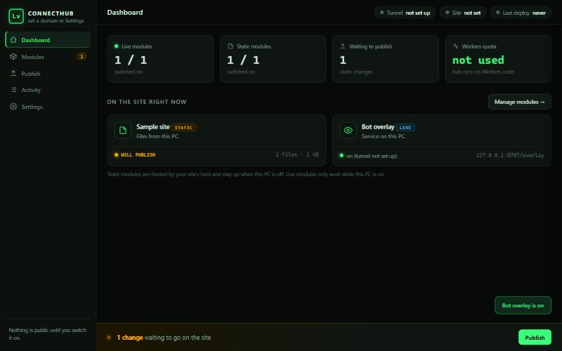

# ConnectHub

A small desktop control panel for your personal site. Pick what visitors can see from a window on your own PC; the site follows.

> **Status: v0.1, the foundation.** The window, the module list, the safety rules and the change tracking work and are tested. **Publishing to a host and the live tunnel are not built yet.** See [Roadmap](#roadmap).



## The idea

Most personal sites need a code change and a push every time you want to show something new. ConnectHub flips that: you keep a list of **modules** on your PC, switch them on or off, and the site reads that list.

There are two kinds of module:

| Kind | What it is | Where it is served from |
|---|---|---|
| **Static** | A file or folder: a game, images, a page, JSON | Uploaded to your host. Stays up when your PC is off. |
| **Live** | A web service running on your PC | Reached through a tunnel, only while your PC is on. |

## Run it

Needs Python 3.10 or newer. No packages to install.

```
git clone <this repo>
cd connecthub
python -m connecthub
```

It opens in its own window (Edge or Chrome app mode if you have one, otherwise your browser). `Ctrl+C` in the terminal stops it. It never starts with Windows.

State is kept in `%LOCALAPPDATA%\ConnectHub` (or `~/.connecthub`). Set `CONNECTHUB_HOME` to move it.

## Safety rules (enforced in code, covered by tests)

- **Deny by default.** A new module is switched off. A live module shares no fields until you allow them.
- **Locked fields.** Anything named like `chat`, `notes`, `loot`, `account`, `password`, `token`, `secret`, `email`, `cookie` or `session` can never be allowed, even if the service returns it.
- **Never published.** Dotfiles, `.env`, keys (`.pem`, `.key`), `id_rsa*`, logs, backups and `TIMELINE.md` are skipped from any folder you add. Files over 25 MB are reported, not included.
- **This PC only.** Live modules must point at `127.0.0.1` or `localhost`. Anything else is refused.
- **Local server hardening.** It binds to `127.0.0.1`, checks the `Host` header (DNS rebinding), requires a per-launch token on every API call, and rejects foreign `Origin`s.
- **No credentials.** ConnectHub never asks for or stores a password. Deploying uses your own `wrangler` login.

## Roadmap

1. **Done:** window, modules, add wizard, locked fields, viewer cap setting, pending-change tracking, activity log, 28 tests.
2. **Next:** static publishing: build the site plus enabled modules, write a `manifest.json` the site reads, and deploy to Cloudflare Pages with `wrangler`.
3. **Then:** live modules: a hub that serves only enabled modules and filtered fields, behind a Cloudflare Tunnel, with a viewer cap and an "offline" state on the site.

The design is in [docs/ARCHITECTURE.md](docs/ARCHITECTURE.md).

## Tests

```
python -m unittest discover -s tests -t .
```

## License

MIT. See [LICENSE](LICENSE).
