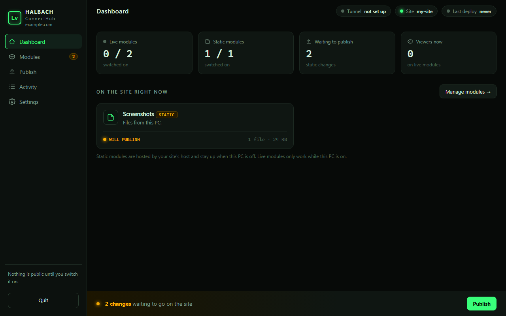

# Halbach ConnectHub

A small desktop control panel for your personal site. Pick what visitors can see from a window on your own PC; the site follows.



## The idea

Most personal sites need a code change and a push every time you want to show something new. Halbach ConnectHub flips that: you keep a list of **modules** on your PC, switch them on or off, and the site reads that list.

| Kind | What it is | Where it is served from |
|---|---|---|
| **Static** | A file or folder: a game, images, a page, a PDF | Uploaded to Cloudflare Pages. Stays up when your PC is off. |
| **Live** | A web service on your PC that returns JSON | Reached through a Cloudflare Tunnel, only while your PC is on. |

Drop a folder in, switch it on, press **Publish**. Edits inside a folder you have added show up as pending changes on their own. Live data needs no publish: switch it on and visitors see it within seconds.

## What works

- Add static modules (file or folder) and live modules (a local `127.0.0.1` service), switch them on and off.
- **Static publishing:** builds the site plus switched-on modules, writes a `manifest.json`, deploys with `wrangler pages deploy`, then checks the live site shows the new build. Scripts and stylesheets get content-hashed file names, so a changed file can never be served stale from a cache. **Test publish** uploads to a private preview address and leaves the live site alone.
- **Live modules:** a second local server (the "live hub") is the only thing the tunnel points at. It serves a module only while it is on, passes only the fields you allowed, caps viewers, and caches so a crowd makes one request a second to your service. **Discover fields** reads them from the service for you.
- **Per-module options:** hide items by name (dropped on your PC, never published), choose how the site shows a live module (generic cards, or a purpose-built view such as **Pets**, which gets its own nav tab), set its refresh rate, and keep asset-only folders (sprite sheets) out of the MORE list.
- **Tunnel:** start and stop a Cloudflare named tunnel from the window; on Windows the connector dies with the hub, even if the hub is force-killed.
- **Drop-off inbox:** other tools and chats can send a folder, file or Markdown text with `halbach submit`. It arrives as a switched-off module marked "from a chat", with a preview, and nothing goes public until you review it, switch it on and press Publish. See [Sending things from other tools and chats](#sending-things-from-other-tools-and-chats).
- The site shows each module by type (page, Markdown doc, game via Ruffle, gallery, image, file) and shows "offline" for live modules when your PC is off.
- Activity log, pending-change tracking, Quit button. It never starts with Windows.

## Run it

Needs Python 3.10 or newer. No packages to install.

```
git clone https://github.com/Levatat3/HalbachConnectHub.git
cd HalbachConnectHub
python -m halbach_connecthub
```

Or install it with `pip install git+https://github.com/Levatat3/HalbachConnectHub.git` and run `halbach`. On Windows you can also double-click `Start Halbach ConnectHub.bat` (no console window). It opens in its own window (Edge or Chrome app mode if present, otherwise your browser). Use **Quit** in the sidebar to stop it. Only one hub can run per state folder: launching it again just opens the running one.

State is kept in `%LOCALAPPDATA%\HalbachConnectHub` (or `~/.halbach-connecthub`). Set `HALBACH_HOME` to move it. An older `%LOCALAPPDATA%\ConnectHub` folder is still used if it exists and the new one does not, and `CONNECTHUB_HOME` still works.

## Sending things from other tools and chats

Anything that can run a command can put something in front of you for review, without touching the hub's state or the internet:

```
halbach submit ./my-project-notes --name "My project" --desc "Status and results"
halbach submit notes.md --name "Notes"            # a lone .md file becomes a page
type notes.md | halbach submit --stdin --name "Notes"
```

(Without installing: `halbach-submit.bat` in this repo does the same on Windows, and `python -m halbach_connecthub submit` works anywhere.)

What happens next:

1. The files are copied into the hub's `inbox` folder (the never-publish list is applied on the way in; a leading byte-order mark is removed from Markdown).
2. While the hub is open it notices the folder within a few seconds and lists it as a **switched-off module** marked **FROM A CHAT**, with a banner on the dashboard.
3. Open it: you see the file list and the start of the text, and nothing is rendered as HTML.
4. Switch it on (or **Mark as reviewed**), then press **Publish**. Removing a submission moves its folder aside instead of deleting it.

A submission can only ever *wait*: it cannot publish, cannot switch itself on, and cannot reach outside the inbox. Limits: 100 MB per submission and 100 submissions waiting.

A ready-made Claude Code skill, [`examples/claude-skill/halbach-publish`](examples/claude-skill/halbach-publish/SKILL.md), teaches a chat to wrap a project up as a public-safe Markdown page and submit it. Copy it to `~/.claude/skills/` and say "wrap this up for Halbach".

## Set it up for your site

1. **Settings:** set the site folder (the folder your site is built from), the Cloudflare Pages project name, your domain, and the live host (for example `live.example.com`).
2. **Publishing** needs [Node.js](https://nodejs.org) and a one-time `npx wrangler@4 login`. Halbach ConnectHub uses that login; it never sees your credentials.
3. **Your site** needs to read `manifest.json` and render modules. A reference script is in [examples/](examples/); the format is below.
4. **Live modules** need [cloudflared](https://developers.cloudflare.com/cloudflare-one/connections/connect-networks/downloads/) and a one-time setup, shown in Settings:
   ```
   cloudflared tunnel login
   cloudflared tunnel create halbach
   cloudflared tunnel route dns halbach live.example.com
   ```
   Put `cloudflared.exe` on your PATH, or in the `bin` folder inside the state folder. Halbach ConnectHub never downloads it for you. Then press **Start tunnel**.

### manifest.json

```json
{
  "version": 1,
  "build": "71abba93d035",
  "live_base": "https://live.example.com",
  "modules": [
    {"id": "shots", "name": "Screenshots", "kind": "static", "type": "gallery",
     "entry": "modules/shots/", "files": ["modules/shots/a.png"]},
    {"id": "bot", "name": "Bot stats", "kind": "live"}
  ]
}
```

`type` is one of `page`, `doc`, `game`, `gallery`, `image`, `file`. Live data is `GET <live_base>/status` (which modules are on) and `GET <live_base>/m/<id>` (filtered JSON: one object, or a list of objects such as a list of bots, with the same allow-list applied to every item).

## Safety rules (enforced in code, covered by tests)

- **Deny by default.** A new module is switched off. A live module shares no fields until you allow them.
- **Locked fields.** Anything named like `chat`, `notes`, `loot`, `account`, `password`, `token`, `secret`, `email`, `cookie` or `session` can never be allowed, and is removed at every depth of the JSON, even if the service returns it.
- **Never published.** Dotfiles, `.env`, keys, `id_rsa*`, logs, backups and `TIMELINE.md` are skipped from any folder you add. The site folder's own `README.md` is never uploaded. Files over 25 MB are reported, not included.
- **This PC only.** Live modules must point at `127.0.0.1` or `localhost`, and the hub does not follow redirects.
- **Small attack surface.** The tunnel reaches only the live hub (read-only `GET /status` and `GET /m/<id>`). The control panel is a separate loopback server with a per-launch token, `Host` and `Origin` checks and a strict Content-Security-Policy; it is not reachable through the tunnel.
- **No credentials.** Halbach ConnectHub never asks for or stores a password. Publishing uses your `wrangler` login and the tunnel uses cloudflared's own certificate.

## Tests

```
python -m unittest discover -s tests -t .
```

## Limits

- Live modules are polled JSON, not streams. Each viewer polls every few seconds; the hub caches for one second.
- The change detector uses whole-second modification times.
- Live data is only as available as your PC and home upload.
- See [docs/ARCHITECTURE.md](docs/ARCHITECTURE.md) for the design and threat model.

## License

MIT. See [LICENSE](LICENSE).
