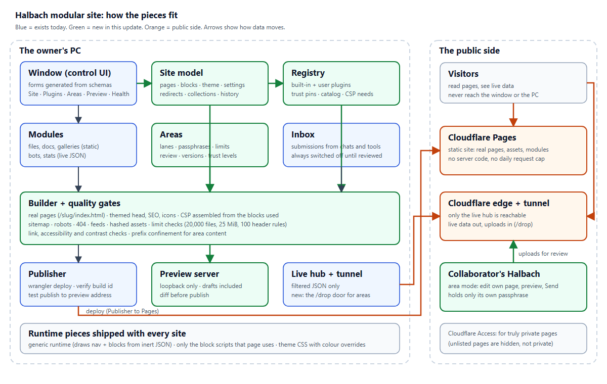
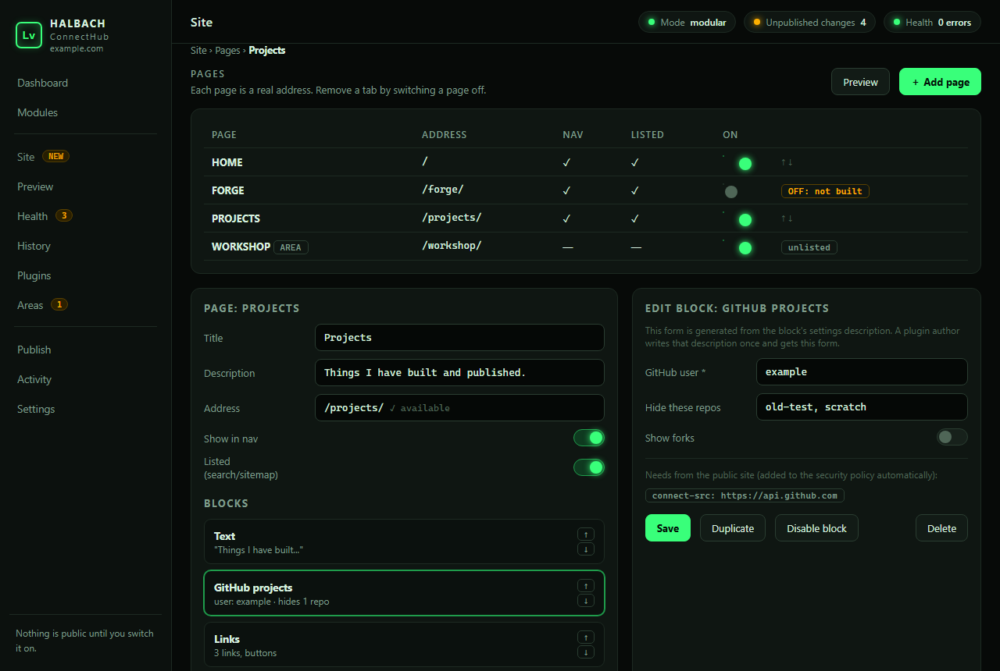
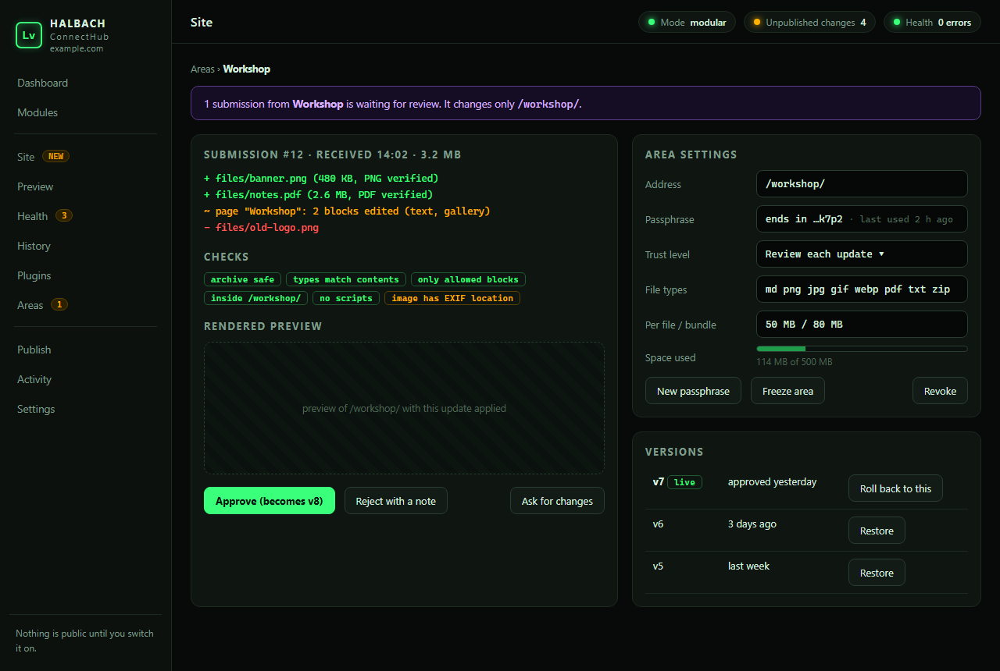
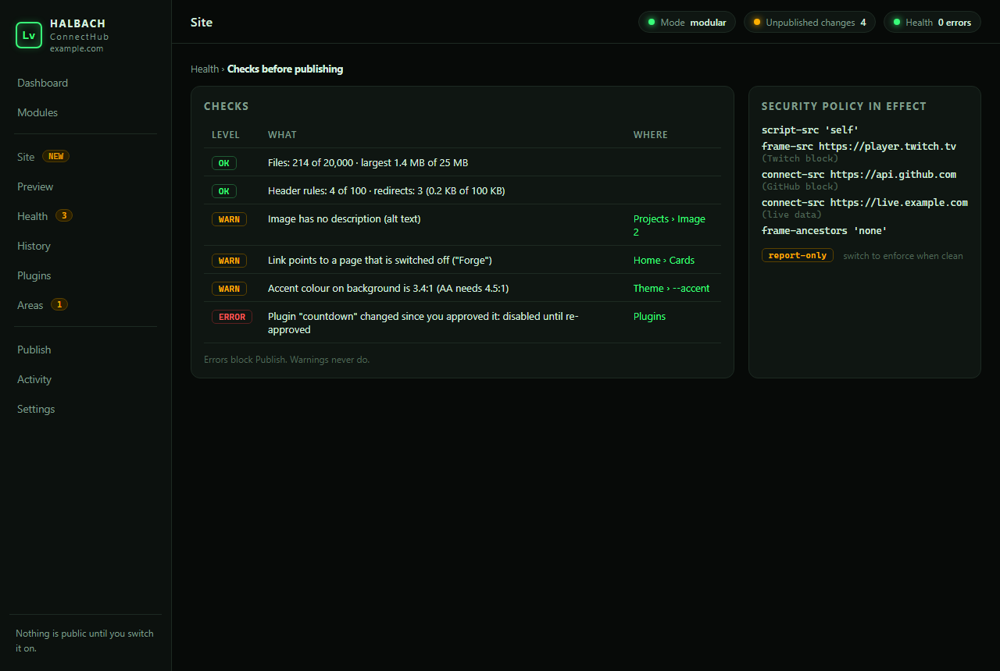

# Halbach modular update: the plan

Status: **plan and scaffold only** (branch `modular-site`). Nothing here changes how the current release behaves. Companion documents live in `docs/design/`: `RESEARCH.md` (what was checked and why), `SITE-MODEL.md` (the model and the build), `PLUGINS.md` (blocks, views, themes), `AREAS.md` (lanes for collaborators).



## 1. The goal in one paragraph

Halbach controls **everything on the site** from its window, and everything it controls is replaceable. The site is described as data (pages made of blocks, a theme, settings); blocks, live-data looks, themes and templates are plugins that anyone can write or swap; other people can be given a lane (an *area*) where they manage their own page without ever holding a key. The output stays a plain static site on Cloudflare Pages. There is no drag-and-drop page builder: editing is forms, lists and files.

## 2. Non-goals (decided, with reasons)

| Not doing | Why |
|---|---|
| A visual drag-and-drop builder | Not wanted; forms generated from schemas are simpler, testable and accessible. |
| A database or server-side rendering | Output stays static; dynamic things ride the live hub through the tunnel. |
| A remote login/editor on the owner's PC | A public login is a far bigger attack surface than a one-way submission lane. Collaborators edit in their own Halbach and send. |
| Auto-downloading plugins | Plugins are code running on the public site; installing is always an explicit, local act. |
| Third-party fonts, trackers, tag managers by default | Privacy and CSP cost; possible only through a declared plugin. |
| Pretending a static page can be private | Documented recipe with Cloudflare Access instead. |

## 3. Architecture

Layers, each replaceable:

1. **Core hub** (exists): control window, state, instance lock, publisher, live hub, tunnel, inbox, modules.
2. **Site model** (new): `site.json` plus history; pages, blocks, theme, settings, redirects, collections.
3. **Registry** (new): discovers built-in and user plugins, validates manifests, tracks trust and hash pins, produces the catalog the window and the builder use.
4. **Builder** (new): turns model + plugins + modules into a stage folder with real pages, CSP/headers, sitemap, robots, icons, feeds; runs the quality gates; feeds the existing publisher.
5. **Runtime** (new, browser): one small generic script that draws nav and blocks from the page's inert JSON and loads only the block scripts in use.
6. **Plugins** (new): blocks, views, themes, templates (browser or data); importers/exporters (Python, off by default).
7. **Areas** (new): lanes with passphrases, limits, review, versions, trust levels; the drop endpoint on the live hub.
8. **Area mode client** (new): the restricted Halbach a collaborator runs.
9. **Window** (extends today's UI): Site, Plugins, Areas, Preview, Health, History screens.

Data flow for a normal publish:

```
site.json + plugins + modules + area versions  ->  builder (quality gates)  ->  stage/  ->  publisher (existing)  ->  Cloudflare Pages
```

## 4. Package layout (target)

```
halbach_connecthub/
  (existing) store.py server.py publisher.py live.py tunnel.py single.py submit.py net.py ui/
  siteschema.py     field types, validation, URL/slug/id rules, sanitising
  sitemodel.py      load/save/migrate/validate, history snapshots, templates, reserved slugs
  registry.py       plugin discovery, manifests, trust pins, catalog
  sitebuilder.py    model -> stage; head template, CSP assembly, sitemap, robots, feeds, 404
  quality.py        link/a11y/contrast/size/limit checks
  icons.py          favicon set generated from the mark (stdlib PNG encoder + tiny bitmap font)
  collections.py    front matter, pagination, tag pages, feeds
  legacyimport.py   starter-site -> model
  areas.py          lanes, keys (scrypt), limits, versions, trust, audit
  bundle.py         safe bundle validation and streaming extraction
  dropserver.py     /drop routes on the live hub: auth, rate limits, size streaming
  areaclient.py     area mode: connect, pack, pre-check, send, status
  plugin_dev.py     halbach plugin new/check/pack
  cli.py            halbach build / publish / site / plugin / area subcommands
  builtin/          runtime, blocks, themes, templates (as scaffolded)
  ui/               app.js plus site.js, plugins.js, areas.js
docs/ docs/design/ docs/img/
tests/              one file per module plus tests/corpus/ (hostile bundles, malformed models)
examples/plugins/   a worked example of every kind
```

## 5. The window (screens)

| Screen | What you do there |
|---|---|
| **Dashboard** (exists) | Status tiles; now also: pending site changes, areas waiting for review, health warnings. |
| **Modules** (exists) | Files and live services as today. |
| **Site > Pages** | List of pages with enable, nav, listed, draft toggles; add, rename, move up/down, delete, duplicate; slug editor with live availability check. |
| **Site > Page editor** | The page's settings (title, description, image, theme) and its block list: add from the catalog, edit in a schema-generated form, reorder, duplicate, delete, disable one block. |
| **Site > Theme and brand** | Theme picker, colour pickers for the theme's variables, light/dark/auto, brand name/mark/tagline/footer, icon mode and a live icon preview. |
| **Site > Navigation and redirects** | Nav order and grouping, external nav links, redirects table with size meter. |
| **Site > Settings** | Language, base URL, indexable, CSP mode, analytics, search, nav style. |
| **Preview** | Local preview of the built site (drafts included), page picker, device widths. |
| **Health** | Every quality gate result with links to the offending page/block; file count and size budget meters; the final CSP and who asked for each host. |
| **History** | Site snapshots (restore, compare), publish log, rollback to a previous deployment. |
| **Plugins** | Installed blocks/views/themes/templates, trust state, hashes, Enable/Disable, install from zip, the dev preview. |
| **Areas** | Lanes: create, passphrase (shown once), limits, allowed blocks, trust level, freeze; submissions queue with diff and rendered preview; versions and rollback; audit log. |
| **Publish** (exists) | Now with the diff and the quality gates in front. |
| **Settings** (exists) | Plus the site mode switch (classic or modular) and export/import. |

All forms are generated from schemas; every list has keyboard-reachable up/down controls; there is no WYSIWYG.

Mockups of three of the new screens (static, built from the real window's stylesheet; source in `design/modular-mockup.html`):

| Page editor | Area review | Health checks |
|---|---|---|
|  |  |  |


## 6. Feature inventory (nothing left out)

Legend: **have** = exists today · **P1-P6** = planned phase · **later** = deferred with the reason · **no** = decided against.

### Site structure
| Feature | State |
|---|---|
| Pages at real addresses (`/slug/`), nested slugs | P1 |
| Home page at `/` | P1 |
| Enable/disable a page (remove a tab without losing it) | P1 |
| Draft pages (preview only) | P1 |
| Unlisted pages (no nav, no sitemap, noindex) | P1 |
| Nav order, labels, grouping, external nav links | P1/P2 |
| Per-page theme override | P2 |
| Custom 404 page | P1 |
| Redirects (renames, case variants) with size check | P1 |
| Legacy `#hash` address redirect | P1 |
| Collections: blog/changelog entries, pagination, tags, Atom feed | P5 |
| Multi-language with `hreflang` | P6 |
| Search (client-side index) | P5 |

### Blocks (built in)
hero, text/markdown, cards, links, divider, twitch, youtube, ruffle-game, embed, module-list, module-view, live-view, github-projects, gallery, image, files: **P1**. Contact/drop box: **P4**. Countdown, guestbook-via-inbox, map, table, FAQ/accordion, timeline, stat tiles, pricing/CTA, testimonial, newsletter-via-inbox, code block with copy: **P5 examples** (shipped as example plugins, proving the plugin path).

### Theming
| Feature | State |
|---|---|
| Theme picker; retro-terminal (current look), neutral dark, neutral light | P1/P2 |
| Colour variables as pickers; light/dark/auto | P2 |
| Semantic class contract for third-party themes | P1 |
| Effects as opt-in modules (scanlines, glyph rain, typed heading), reduced-motion honoured | P2 |
| Self-hosted fonts via a theme's `.woff2` | P3 |
| Print styles, high-contrast variant | P2 |
| Nav layouts (top, side, none), container widths, density | P3 |

### Plugins
| Feature | State |
|---|---|
| Block, view, theme, template plugin kinds | P3 |
| Manifest, schema-generated forms, host API v1 | P3 |
| Trust: explicit Enable, SHA-256 pin, disabled on change | P3 |
| CSP built from what used plugins declare | P1 (blocks) / P3 |
| Isolated (sandboxed iframe) blocks | P3 |
| Dev kit: new / check / pack, dev preview with live reload | P3 |
| Importer/exporter kinds (Python, off by default) | P6 |
| Plugin index file with hash-verified install | later (folder/zip is enough first) |
| Plugin signing | later (hash pinning covers integrity; identity needs infrastructure) |

### Build quality
| Feature | State |
|---|---|
| Content-hashed assets, immutable caching | **have** (publisher), P1 for all generated assets |
| Limit checks (20,000 files, 25 MiB, 100 header rules, redirect caps) | P1 |
| sitemap.xml, robots.txt, canonical, Open Graph, Twitter cards, JSON-LD | P1 |
| Generated favicon set and web app manifest from the brand mark | P2 |
| Generated social card image per page | later (needs an image renderer; default card first) |
| Link checker, accessibility lint, contrast check, image-size warnings | P2 |
| Server-rendered fallback for text blocks (no-JS, crawlers) | P5 |
| Image thumbnails/modern formats | later, optional `halbach[images]` extra (Pillow) |
| Strict CSP (enforce / report-only / off) | P1 |

### Operations
| Feature | State |
|---|---|
| Local preview including drafts | P1 |
| Test publish to preview address | **have** |
| Publish with verification of the live build id | **have** |
| Diff before publish | P2 |
| Site history (100 snapshots) and restore | P2 |
| Roll back to a previous deployment | P2 |
| Export/import whole site as a zip | P2 |
| Headless build/publish CLI for scheduled tasks and CI | P2 |
| Scheduled publish (only while the hub runs; says so) | later |
| Analytics: none or Cloudflare (cookieless) | P2 |
| Health screen | P2 |

### Collaboration
| Feature | State |
|---|---|
| Inbox for submissions from chats and tools | **have** |
| Areas: lanes, passphrase, limits, allowed blocks | P4 |
| Drop endpoint with auth, rate limits, streaming caps | P4 |
| Bundle validation (archive safety, magic numbers, quotas) | P4 |
| Review with diff and rendered preview; approve/reject with notes | P4 |
| Versions and one-click rollback per area | P4 |
| Trust levels (review, trusted, auto) and freeze | P4 |
| Audit log per area | P4 |
| Area mode client (edit, preview, send, status) | P4 |
| Notification hook (plugin) | P4/P5 |
| Chunked uploads beyond the proxy limit | later |
| Private areas via Cloudflare Access recipe | P4 (documentation + in-window guide) |

### Releasing and community
| Feature | State |
|---|---|
| Neutral default theme and starter templates (blank, personal, streamer) | P1/P6 |
| One-page "new site" wizard | P6 |
| Docs: model, plugins, areas, security, migration; worked example per plugin kind | P3-P6 |
| Plugin gallery in the README | P6 |
| Versioned state with automatic backup before every migration | P1 |

## 7. Phases

Each phase ships working on its own, behind the classic/modular switch, with tests. Sizes: S ≈ a few hours, M ≈ a day, L ≈ several days of focused work.

### Phase 1: foundation (L)
**Build:** `siteschema`, `sitemodel` (load/save/validate/migrate, history stub), `registry` (built-ins only), `sitebuilder` (pages, head template, CSP, sitemap, robots, 404, headers/redirects with limit checks), the runtime and the built-in blocks and the retro-terminal theme re-expressed from today's site, `legacyimport`, preview route, classic/modular switch (classic stays default), tests.
**Acceptance:** importing the current starter site and building it reproduces every page's content; a side-by-side screenshot comparison (headless browser) of each page shows only intended differences; the old `#hash` links redirect; CSP does not block anything the site uses (checked in a real browser console); the classic mode output is byte-for-byte unchanged; limit checks fail loudly; the state backup is created before the first write.

### Phase 2: the editor, theming and operations (L)
**Build:** Site screens (pages, page editor with schema forms, theme and brand, nav and redirects, settings), generated icons, quality gates and the Health screen, diff-before-publish, history/restore/rollback, export/import, headless CLI, analytics option, themes neutral dark/light.
**Acceptance:** every operation the owner previously asked an assistant for (remove a tab, reorder, retitle, change a colour, add a page, hide a page) is doable in the window and verified by tests that drive the API; a Lighthouse-style pass (accessibility, SEO) has no errors on generated sites; undo restores exactly.

### Phase 3: plugins (L)
**Build:** user plugin folders, manifest validation, trust pins, Enable/Disable, install from zip, isolated blocks, view and theme plugins, the dev kit (`new/check/pack`, dev preview), example plugin per kind, docs.
**Acceptance:** each example builds into a site and renders in a browser; a plugin whose file is edited is disabled with a clear error; `check` rejects a corpus of bad plugins (traversal, symlink, `eval`, huge files, wrong hostapi); the CSP lists exactly what enabled plugins asked for.

### Phase 4: areas and area mode (L)
**Build:** `areas`, `bundle`, `dropserver`, review/approve/reject/versions/rollback/trust levels/audit, area merge in the builder with prefix confinement, the Areas screens, `areaclient` and the restricted area-mode window, CLI parity, docs and the Cloudflare Access recipe.
**Acceptance:** a hostile-bundle corpus (zip slip, symlinks, bombs, double extensions, SVG with script, huge names, Unicode tricks, case collisions, lying `Content-Length`, slow-loris style slow uploads) is rejected without writing outside quarantine; a bundle cannot change anything outside its prefix; brute-force attempts are locked out; an area-mode client can edit, preview, send and see the review result end to end against a local hub.

### Phase 5: content and polish (M)
**Build:** collections (blog, feed, tags, pagination), search, server-rendered fallback for text blocks, the set of example block plugins (countdown, accordion, timeline, stat tiles, code block, contact form via inbox, newsletter via inbox).
**Acceptance:** a sample blog builds with a valid Atom feed; no-JS rendering shows the text content; search finds page titles and headings.

### Phase 6: release readiness (M)
**Build:** templates and the "new site" wizard, importers/exporters, multi-language, README gallery, final docs pass, security review (independent re-read of the drop endpoint and builder), accessibility pass, packaging and a clean-install run on a machine with nothing configured.
**Acceptance:** a stranger can go from clone to a working custom site using only the README; every doc code sample runs in a test.

## 8. Protecting the running setup

1. **Separate branch and folder.** All work happens on `modular-site` in its own working folder. The running hub keeps using the release folder until the owner merges.
2. **Classic mode is the default.** The modular system is dormant until the owner switches the site mode. Classic publishing is untouched, including content-hashed assets, modules, live data, areas of today (the inbox).
3. **Versioned state with backups.** The first time new code opens an old state file it writes `state.json.bak-<timestamp>`; every migration is a function with a test using a captured copy of a real old state.
4. **Import, preview, compare, then switch.** "Import current site" builds a model; the preview and the test-publish address show it; a screenshot diff proves equivalence; only then does the switch flip, and flipping back is one setting.
5. **Old addresses keep working.** `#hash` redirects in the runtime; `manifest.json` stays in its current format so cached older scripts keep working; modules keep their paths.
6. **One publisher.** The modular builder feeds the same deploy-and-verify code; its failure modes are already tested.
7. **Operational rules carried over:** one hub per state folder (instance lock); stop every hub process before editing state offline; the tunnel connector dies with the hub.

## 9. Testing strategy

- **Unit:** every validator (slug, id, URL, props per field type, manifest), model load/save/migrate, builder pieces (head, CSP assembly, sitemap, headers/redirect counting), icon renderer, front-matter parser.
- **Golden builds:** fixed models produce fixed trees (hash-compared), so accidental output changes are visible in review.
- **Property tests (stdlib `random`):** arbitrary strings in props never produce HTML in a built page; arbitrary slugs are rejected or normalised safely.
- **Hostile corpus:** `tests/corpus/` with real malformed bundles, models and plugins; each must be refused with a specific reason and no side effects (verified by diffing the filesystem before and after).
- **Browser checks:** a headless-browser script loads built sample sites, asserts no console errors/CSP violations, that every tab/page renders, that blocks animate/draw, and takes screenshots for the legacy comparison.
- **Concurrency/crash:** instance lock, atomic writes under kill, temp-file cleanup after interrupted uploads.
- **Load:** the drop endpoint under concurrent uploads, slow clients, oversize bodies.
- **Docs are tests:** every command and JSON sample in the docs is executed in CI-style tests.
- **Clean install:** build the wheel, install in a fresh virtualenv, run the headless flow.

## 10. Risks and mitigations

| Risk | Mitigation |
|---|---|
| Scope is large | Phases ship independently behind a switch; the plan orders them so value arrives early (P1+P2 deliver "control the site from the window"). |
| CSP breaks the site in ways tests miss | `report-only` mode first; browser-console checks in the acceptance tests; `enforce` only after a clean run. |
| A plugin author ships something unsafe | Explicit trust, hash pins, declared CSP, isolation option, no remote loading, lint in `check`. |
| The drop endpoint becomes the weak point | It is the only new public door, so it gets the strictest rules, the corpus tests and an independent review in Phase 6; disabled until an area exists; feature-flagged off by default. |
| Generated sites accumulate cruft or hit limits | Counters and hard checks for files/size/headers/redirects; stage rebuilt clean each time. |
| Cached old scripts break after the switch | Content-hashed names (done), `manifest.json` compatibility, hash redirects. |
| Home upload and PC availability | Static content lives on Pages; only live data and the drop door depend on the PC, and each says "offline" gracefully. |
| Python-only core limits image handling | Optional extra; warnings when absent; no image work in the default path. |

## 11. Decisions to confirm (recommended defaults in bold)

1. Default theme for strangers: **neutral dark**; the retro look ships as a theme.
2. Home page address: **`/`**; other pages lowercase with hyphens; redirects for typed capitals **on**.
3. CSP: **report-only for the first release candidate, then enforce**.
4. Analytics default: **off** (Cloudflare analytics available as a switch).
5. Upload limits per file/bundle: **50 MB / 80 MB** (proxy limit is about 100 MB).
6. Areas default trust: **review**; `auto` requires an explicit confirmation text.
7. Plugin isolation default for third-party blocks: **isolated recommended, not forced**.
8. Image processing extra (Pillow) as optional: **yes, optional**.
9. Whether the collaborator's lane also shows an "area" label on the page: **yes, on by default**.
10. Where collaborator notifications go (window only, or a chat hook plugin): **window only to start**.

## 12. Glossary

**Model**: the site as data. **Page**: one address. **Block**: one piece of content on a page. **View**: a look for live data. **Theme**: colours and layout. **Template**: a starting model. **Plugin**: a block/view/theme/template folder. **Module**: a file set or live service (as today). **Area**: a lane for a collaborator. **Submission**: one upload waiting for review. **Stage**: the folder the builder writes before deploying. **Classic mode**: today's hand-written-site publishing. **Modular mode**: the new data-driven publishing.
